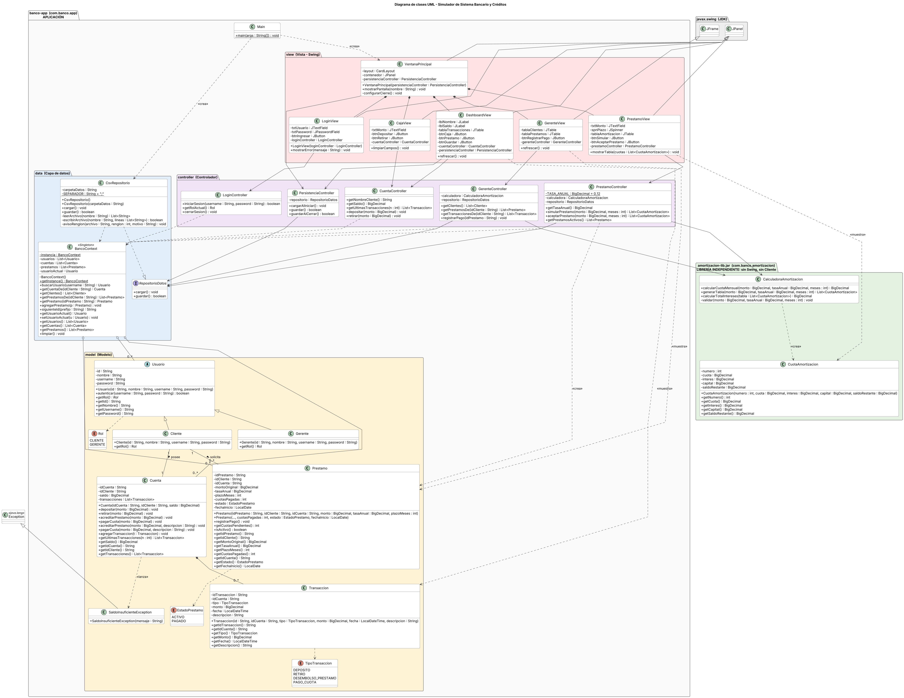
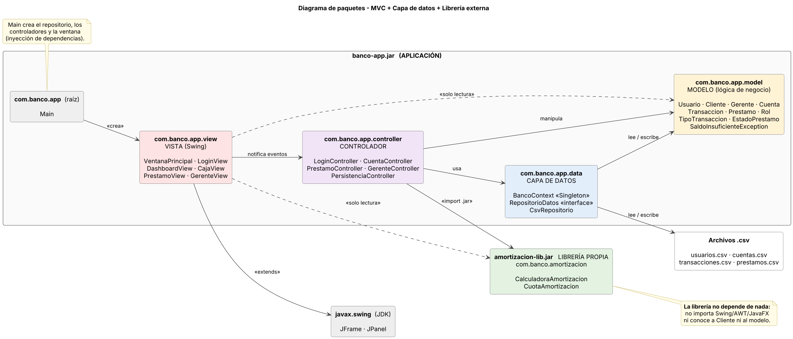
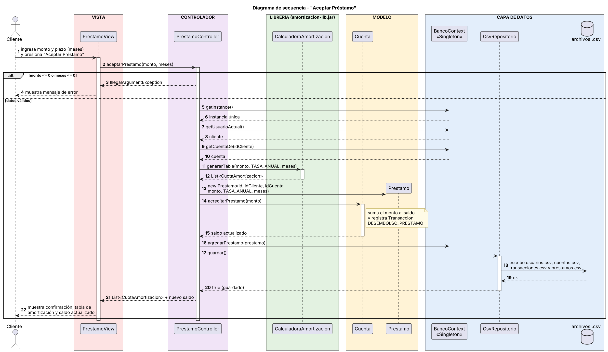

# Diseño UML - Simulador de Sistema Bancario y Créditos

Fase 1 del proyecto. Los diagramas están en PNG (entrega) y en PlantUML `.puml` (fuente editable).

## Diagramas
1. **Diagrama de clases** - `diagrama-clases.png`
2. **Diagrama de paquetes** - `diagrama-paquetes.png`
3. **Diagrama de secuencia ("Aceptar Préstamo")** - `diagrama-secuencia.png`





## Estructura de proyectos
```
amortizacion-lib/  -> com.banco.amortizacion   (se exporta como amortizacion-lib.jar)
banco-app/         -> com.banco.app (+ view, controller, model, data)
```

## Formato de los archivos CSV (separador `;`, con encabezado)
```
usuarios.csv       id;rol;username;password;nombre            (rol = CLIENTE | GERENTE)
cuentas.csv        idCuenta;idCliente;saldo
transacciones.csv  idTransaccion;idCuenta;tipo;monto;fecha;descripcion
prestamos.csv      idPrestamo;idCliente;idCuenta;montoOriginal;tasaAnual;plazoMeses;cuotasPagadas;estado;fechaInicio
```

## Decisiones de diseño y supuestos
- **Gerente:** es un `Usuario` con su propio login (`Rol.GERENTE`). Puede ver clientes y préstamos y registrar el pago de una cuota, que se debita de la cuenta del cliente (`PAGO_CUOTA`).
- **Tasa de interés:** constante `TASA_ANUAL` en `PrestamoController`. La librería la recibe por parámetro (no la conoce).
- **Persistencia:** carga al iniciar; guarda con el botón "Guardar", al cerrar la ventana y al aceptar un préstamo o registrar un pago.
- **Singleton:** `BancoContext` guarda usuarios, cuentas (con sus transacciones) y préstamos.
- **MVC:** las vistas solo llaman al controlador; los controladores usan el modelo, `BancoContext`, el repositorio y la librería.
